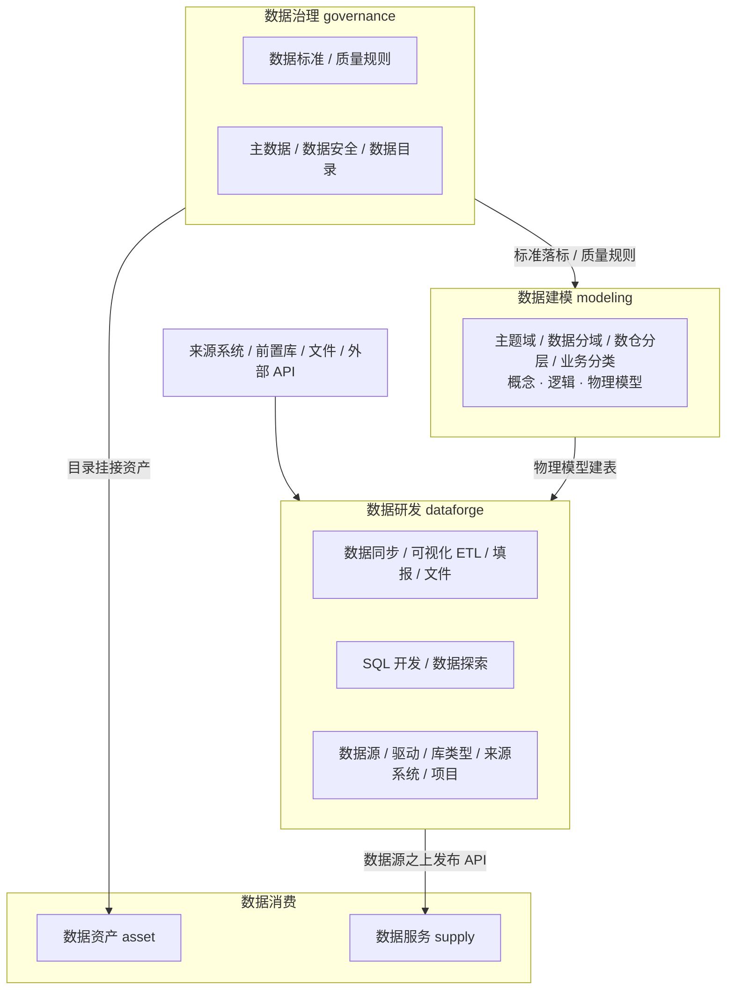

# 数据中台

基于 [芋道 yudao-cloud](https://gitee.com/zhijiantianya/yudao-cloud) `master-jdk25` 分支二次开发的数据中台后端。

目标是把数据接进来、看得见、管得住、用得掉。本仓库只包含后端微服务，管理端前端单独维护。

默认分支：`master-jdk25`  
远程仓库：<https://gitee.com/code-sculptor/yudao-cloud>

## 技术栈

| 项 | 说明 |
| --- | --- |
| JDK | 25 |
| Spring Boot | 4.1.x |
| Spring Cloud | 2025.x |
| 注册中心 / 配置中心 | Nacos |
| 网关 | Spring Cloud Gateway |
| ORM | MyBatis-Plus |
| 数据库 | PostgreSQL 为主，兼容达梦、人大金仓、openGauss 等 |
| 缓存 | Redis |
| 定时任务 | XXL-Job |
| 工作流 | Flowable |
| 数据开发调度 | DolphinScheduler |
| 实时同步 | SeaTunnel（Zeta 引擎） |
| 版本号 | 2026.07-jdk25-SNAPSHOT |

## 架构

中台业务收敛为五个服务：**dataforge**（数据研发）负责把数据接进来、加工出去，同时是数据源的底座；**modeling**（数据建模）定义数据的结构与组织；**governance**（数据治理）管标准、质量、主数据和安全；**asset**（数据资产）与 **supply**（数据服务）把数据以资产和 API 的形式提供出去。



底座沿用芋道：gateway、system、infra、bpm、report、ai。原 foundation 模块已拆掉：数据源、驱动、库类型、来源系统、项目并入 dataforge，并通过 `DatabaseApi` 供 modeling、governance、supply 取连接；业务分类、数仓分层、主题域、数据分域归入 modeling。原 integrate、develop 模块的同步、ETL、填报、SQL 开发、数据探索能力全部并入 dataforge。

约定：

- 全市部署只使用 **一个租户**。表上的 `tenant_id` 按芋道规范保留，不要用它拆委办局。
- 部门、区县用 `org_id` + 数据权限隔离。大数据局看全市，部门数据官只看本部门。
- 跨服务只通过 Feign 读、通过 MQ 写，禁止互相直接改对方业务表。数据源连接统一走 dataforge 的 `DatabaseApi`，不要各自存连接串。
- 业务对象统一挂数据源 ID 和 `org_id`，需要时再挂目录、标准、安全等级。

## 模块

| 模块 | 服务 | 职责 | 现状 |
| --- | --- | --- | --- |
| yudao-gateway | gateway-server | API 网关 | 沿用芋道 |
| yudao-module-system | system-server | 用户、角色、菜单、部门 | 沿用 |
| yudao-module-infra | infra-server | 文件、配置、代码生成 | 沿用 |
| yudao-module-bpm | bpm-server | 共享申请、填报审批等流程 | 沿用 |
| yudao-module-report | report-server | 报表（可选） | 沿用 |
| yudao-module-ai | ai-server | AI 能力（可选） | 沿用 |
| yudao-module-dataforge | dataforge-server | 数据源、驱动、库类型、来源系统、项目；数据同步（离线 / 实时 / API 接入）、可视化 ETL、数据填报、数据文件、SQL 开发、数据探索 | 主体功能已有 |
| yudao-module-modeling | modeling-server | 主题域、数据分域、数仓分层、业务分类；概念 / 逻辑 / 物理模型（含 Doris）、模型检查、落标检查 | 主体功能已有 |
| yudao-module-governance | governance-server | 数据标准（数据元 / 代码集 / 标准文档）、数据质量（稽查 / 清洗规则）、主数据、数据安全（分类分级 / 脱敏规则 / 白名单）、数据目录 | 主体功能已有，元数据采集待建 |
| yudao-module-supply | supply-server | 数据服务：API 定义与发布（单表向导 / SQL / 第三方转发）、应用与授权、签名网关、调用日志 | 主体功能已有 |
| yudao-module-asset | asset-server | 数据资产、共享大厅 | 仅目录资产登记，其余待建 |

本项目不包含：会员、支付、商城、公众号、CRM、ERP、IoT、WMS、MES、IM。

### 能力组件

均位于 `yudao-framework`。业务模块只保存规则和任务元数据，执行逻辑放组件里。

| 组件 | 用途 |
| --- | --- |
| yudao-spring-boot-starter-biz-dbswitch | 多库元数据读取、离线同步、建表 DDL、SQL 方言转换（含 Doris / OLAP 写入） |
| yudao-spring-boot-starter-biz-etl | 可视化 ETL 引擎：DAG 编排、流式执行、内置读写 / 转换 / 脚本节点 |
| yudao-spring-boot-starter-biz-seatunnel | SeaTunnel（Zeta）作业提交，实时同步 |
| yudao-spring-boot-starter-biz-dolphinscheduler | DolphinScheduler REST 客户端及原生任务参数协议，数据开发任务的调度执行底座 |
| yudao-spring-boot-starter-biz-quality | 质量稽查 SQL 生成、清洗函数执行 |

Flink / Spark 任务通过 DolphinScheduler 原生插件提交。匹配版本的引擎客户端、连接器和 Python 环境部署在 DS Worker 或相应集群环境，业务服务通过上述客户端管理任务定义、启动、状态、日志和停止。

业务表前缀统一为 `dh_模块名_`，例如 `dh_dataforge_*`、`dh_modeling_*`、`dh_governance_*`、`dh_supply_*`、`dh_asset_*`。少量历史表仍沿用 `dh_foundation_*`、`dh_safety_*` 前缀。

## 数据集成

统一入口在 dataforge 的「数据同步」，同一个页面按引擎类型区分任务：

| 通道 | 说明 | 引擎 |
| --- | --- | --- |
| 离线库表同步 | 一次性全量，或一次全量 + 周期增量（cron，可配增量策略）；入中台库自动加 `ods_` 前缀，也可自定义目标库 | dbswitch |
| 实时同步 | 提交 SeaTunnel Zeta 作业 | SeaTunnel |
| API 接入 | 把外部 HTTP API 定义为数据源，拉取入库 | dataforge |
| 可视化 ETL | 拖拽 DAG：读写、转换、脚本节点，流式执行 | biz-etl |
| 在线填报 | 设计填报表与字段，人工录入 | dataforge |
| 文件 | 数据文件上传与分类 | dataforge |

原则：能抽则抽，抽不了再填。复杂清洗放到可视化 ETL 或 SQL 开发，不要做进同步任务。

### 在线填报

现状：填报表与字段配置已有；任务下发、按人审批、合并主表在建。设计约定如下。

流程：表单设计 → 发布任务并选人 → 填报计算 → 按人上报 → 按人审批 → 通过后合并主表 → 汇总查询。

规则：

- 填写人之间数据互相不可见，合并进主表后仍然只能看自己的行
- 发起人、管理员可看本期全量，用于催报和汇总
- 按人提交、按人审批、按人合并，不等全员齐了再进主表
- 主表必须带 `task_id`、`filler_user_id`、`org_id`
- 网页填报与 Excel 导入使用同一套校验；计算公式以服务端重算为准
- 已发布表单改字段必须升版本；进行中的任务冻结旧版本
- 已入主表后改数必须走修订单

## 建设顺序

| 阶段 | 内容 | 完成标准 |
| --- | --- | --- |
| P0 | 数据源实例、测通、浏览表字段；组织 `org_id` | 能连上库并展开表结构 |
| P1 | 元数据采集 | 源库新增表后采集可见 |
| P2 | 一条离线库表同步 | 目标表数据对齐，并回写元数据 |
| P2.5 | 在线填报一期 | 按人填报、审批、合并、行级隔离 |
| P3 | 政务目录 + 共享申请 | 能提单、能审批、能留下授权范围 |
| P4 | 一条受控数据服务 API | 有授权能查，无授权拒绝，调用可审计 |
| 其后 | 标准落标、脱敏、质量、主数据、开放 | 按需展开 |

第一期对外演示以 P0～P4 跑通一条闭环为准，不要同时铺开全部模块。

## 目录结构

```
yudao-cloud
├── script                       # docker-compose、IDEA HTTP Client 环境
├── sql
│   └── postgresql               # ruoyi-vue-pro.sql（系统库）、quartz.sql、datahub.sql（dh_ 业务表）
├── yudao-dependencies
├── yudao-framework              # 含 dbswitch、etl、seatunnel、dolphinscheduler、quality 等能力组件
├── yudao-gateway
├── yudao-server
├── yudao-module-system
├── yudao-module-infra
├── yudao-module-bpm
├── yudao-module-report
├── yudao-module-ai
├── yudao-module-dataforge       # 数据研发：数据源、同步、ETL、填报、开发、探索
├── yudao-module-modeling        # 数据建模：主题域、分层、分类、概念 / 逻辑 / 物理模型
├── yudao-module-governance      # 数据治理：标准、质量、主数据、安全、目录
├── yudao-module-supply          # 数据服务：API 发布、授权、签名网关
└── yudao-module-asset           # 数据资产
```

## 环境要求

- JDK 25
- Maven 3.8+
- Nacos
- Redis
- PostgreSQL（或项目指定的国产库）
- 可选：XXL-Job（定时同步 / 周期任务）、DolphinScheduler（SQL 开发任务执行）、SeaTunnel Zeta（实时同步）
- 前端单独仓库所需的 Node.js

## Maven 构建

本项目通过 `.mvn/maven.config` 同时将 Maven 用户和全局 settings 指向 `.mvn/settings.xml`，使用项目 POM 中的仓库和 Maven Central，避免加载本机公司私服配置。公司 Maven 安装目录和其他项目的 settings 无需修改。

在后端仓库根目录（`yudao-cloud`）执行，`.mvn/maven.config` 中的路径相对此目录解析：

```bash
mvn -U clean package
# 只构建指定模块及其依赖，也从根目录执行
mvn -U -pl :yudao-module-dataforge-server -am package
```

IDEA 的 Maven 设置中勾选 **Use settings from .mvn/maven.config**，将 **User settings file** 设置为本项目的 `.mvn/settings.xml`，然后重新加载 Maven 项目。本地依赖缓存目录可继续沿用原设置。不要在运行配置中再显式传入公司 settings 的 `-s` 或 `-gs` 参数，以免覆盖项目配置。

## 本地启动

1. 导入 `sql/postgresql` 下的 `ruoyi-vue-pro.sql`（系统库）、`quartz.sql`，以及中台业务脚本 `datahub.sql`。
2. 启动 Nacos、Redis、数据库；用到 SQL 开发、实时同步时再起 DolphinScheduler、SeaTunnel。
3. 配置各服务的 `application-local.yaml` 或 Nacos 配置（DolphinScheduler、SeaTunnel 地址在 dataforge 配置中），不要把密码提交进 Git。
4. 建议启动顺序：gateway → system-server → infra-server → 其余业务服务。
5. `gateway` 与 `bpm-server` 当前端口都是 48083，需要同时启动时先改开其中一个。

参考端口（以各模块 `application.yaml` 为准）：

| 服务 | 端口 |
| --- | --- |
| gateway | 48083 |
| system-server | 48081 |
| infra-server | 49082 |
| bpm-server | 48083（与网关冲突，同时启动需改开） |
| report-server | 48084 |
| ai-server | 48090 |
| dataforge-server | 50024 |
| modeling-server | 50014 |
| governance-server | 50004 |
| supply-server | 50001 |
| asset-server | 50003 |

## 开发约定

- 新表统一包含：`id, tenant_id, creator, create_time, updater, update_time, deleted`，前缀 `dh_模块名_`
- JSON 配置使用 PostgreSQL `jsonb`，复用各模块已有的 `JsonbTypeHandler` / `JsonbStringTypeHandler`
- 数据源密码使用 MyBatis-Plus 加密存储；连接信息统一从 dataforge 的 `DatabaseApi` 取，Feign 出网关不传明文连接串
- 元数据读取、离线同步、建表 DDL 优先复用 biz-dbswitch，不自写各数据库方言
- 业务分类树复用 modeling 的 `dh_modeling_biz_category`，不要每个模块自己建树
- 安全分类分级、脱敏规则复用 governance 的 `dh_governance_safety_*`，字段上只挂等级和规则 ID

## 相关仓库

| 仓库 | 说明 |
| --- | --- |
| https://gitee.com/code-sculptor/yudao-cloud | 本后端，分支 `master-jdk25` |
| 前端仓库 | 管理后台，单独维护 |
| https://gitee.com/zhijiantianya/yudao-cloud | 上游脚手架，对应 `master-jdk25` |

## 许可证

业务代码按项目组内部规定使用。底层脚手架来自芋道 yudao-cloud，遵循其开源协议。
