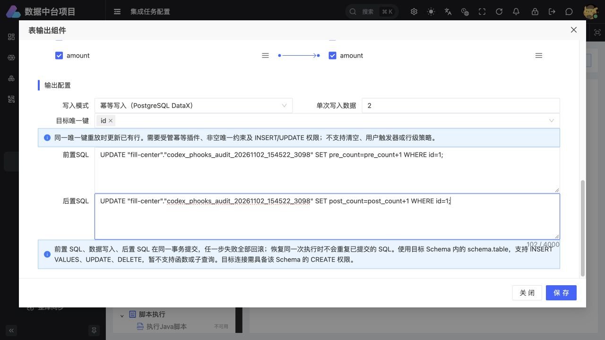

# 前后置 SQL 正式平台链路验收（2026-11-02）

## 验收结论与范围

正式链路 `DataForge API → 正常本地 DolphinScheduler → PostgreSQL` 验收通过。使用既有网关 48083、IDE 启动的 DataForge 50024 和原正常本地 DS 12345；没有创建独立测试服务，也没有新增端口。

本报告依据 [正式平台结果](verification/sql-hooks-platform-20261102/20261102_154522_3098/result.json)，对应运行批次 `20261102_154522_3098`。它证明配置经过正式 API 检查、保存和发布，实际运行结果能回到平台记录、运维实例和运维日志。

本报告的两次运行是两个新的逻辑执行。前后置计数从 1/1 增加到 2/2 属于正常执行语义。失败恢复及同一已提交逻辑执行的幂等重放，分别记录在 [运行时故障与重放验收](SQL_HOOKS_VALIDATION_20261102.md)，不将新实例计数增加解释为同实例重放失败。

## 正式任务与执行证据

| 项目 | 实际值 |
| --- | --- |
| 平台测试连接 | PostgreSQL 连接 1，Schema `fill-center` |
| 平台类目 / 集成任务 | 1004 / 1006 |
| 正常 DS 项目 | `188590885122016` |
| DS 工作流定义 | `188595331216640` |
| 执行引擎 / 工作组 | DATAX / default |
| 写入契约 | `POSTGRESQL_UPSERT_HOOKS_V2` |
| 流程检查 | valid=true，errors=[] |
| 周期启用次数 / 新服务数量 | 0 / 0 |

任务通过正式 `/create`、`/check`、`/flow`、`/status`、`/run` 接口创建、发布并手动运行。运行过程中，两次均实际观察到 RUNNING，最后平台与运维状态均为 SUCCESS。

| 次数 | 平台执行记录 | DS 实例 | 目标行数 / 唯一 ID | 前置 / 后置计数 | 完整精确数据比对 |
| --- | --- | --- | --- | --- | --- |
| 1 | `180829751977012` | 15 | 5 / 5 | 1 / 1 | 通过 |
| 2，新的逻辑执行 | `180829751977013` | 16 | 5 / 5 | 2 / 2 | 通过 |

每次都通过正式运维 `/dataforge/ops-instance/get` 和 `/log` 接口读取结果；origin=MANAGED、kind=INTEGRATION、taskId=1006，DS 项目与实例身份与平台执行记录一致，状态为 SUCCESS，日志 available=true。

两次日志包含实际阶段标记 `stage-ready`、`stage-batch`、`pre-start/pre-complete`、`merge-complete`、`post-start/post-complete` 和 `publish-committed`。第一次目标合并 changed=5，第二次 changed=0；数据未变化的第二个新实例仍各执行一次配置的前后置 SQL。

- [第一次正式运维日志](verification/sql-hooks-platform-20261102/20261102_154522_3098/attempt-1.log)
- [第二次正式运维日志](verification/sql-hooks-platform-20261102/20261102_154522_3098/attempt-2.log)

## 数据与配置

独立测试表全部保留：

- `fill-center.codex_phooks_src_20261102_154522_3098`
- `fill-center.codex_phooks_target_20261102_154522_3098`
- `fill-center.codex_phooks_audit_20261102_154522_3098`

源表包含五行数据，覆盖精确小数 `90071992547409.93`、负数、中文、引号、分号、NULL、换行、emoji 和两端空格。验收使用 Python Decimal 与实际 PostgreSQL 查询结果逐行完整比较；两次均 fullExactRowsMatch=true，5 行对应 5 个唯一 ID，没有重复、遗漏或字符内容变化。两次目标 SHA-256 相同：

`f29f7d307c91684b117843692085916af1796c9d8d7685208faffdd00114533a`

流程为表输入 → 表输出，输出使用幂等写入和唯一键 `id`，每批两行。前置 SQL 将审计表 pre_count 加一，后置 SQL 将 post_count 加一。源数据先完整暂存；随后前置 SQL、暂存数据合并、后置 SQL及本次执行完成标记在同一 PostgreSQL 事务中提交，任一步失败则回滚该发布事务。

浏览器实际打开任务 1006 配置，确认前置 SQL 和后置 SQL 两个文本域均可编辑，并回显正式保存的 SQL：

该能力仅用于 PostgreSQL + DataX + 幂等写入模式。SQL 使用明确的 `schema.table`，限目标 Schema 内受校验的 `INSERT VALUES`、`UPDATE`、`DELETE`；不开放任意函数、子查询、DDL、事务控制或外部副作用。目标连接需要目标 Schema 的 CREATE 权限以建立运行时暂存与幂等记录；平台没有自动扩大数据库权限。

## 验收期间修复与保留的失败记录

最初准备脚本给手动作业传入空 Cron，被正式 API 的 Quartz 校验拒绝。现已改为合法表达式 `0 0 0 * * ?`，同时始终保持 scheduleStatus=0，未启用周期。该失败发生在任务创建阶段，没有对应成功运行，记录保留在 [初始准备失败](verification/sql-hooks-platform-20261102/20261102_153909_5153/result.json)。

此前环境尝试创建的任务 1005 在轮询时遇到平台系统异常，该记录仍为 FAIL，不计入成功验收。其执行记录 `180829751977011`、DS 实例 12 及诊断信息保留；后续已停止并确认任务 status=0、scheduleStatus=0、activeRunning=false。结果中保留最初 cleanupError，最终 cleanup 状态反映后续完成的收尾，见 [环境尝试记录](verification/sql-hooks-platform-20261102/20261102_153935_7420/result.json)。

浏览器检查还发现字段映射回显问题：配置先返回、目标元数据后返回时，已保存 enabled=true 的目标勾选被初始化成 false。修复将用户勾选意图与元数据存在性分离；实际执行的序列化仍要求字段存在。新增用例覆盖元数据迟到后的启用/禁用恢复，以及用户手动修改在元数据重载后保持。修改前一项回归用例失败，修改后字段映射与数据库编辑器合计 16 项测试通过，目标文件 ESLint 与 diff 检查通过。

## 收尾状态

正式任务 1006 最终 status=0、scheduleStatus=0、activeRunning=false，已下线且没有活动实例。测试表、任务定义、执行记录和脱敏日志全部保留。

可复现实验入口：[normal_sql_hooks_platform_acceptance.py](normal_sql_hooks_platform_acceptance.py)。该脚本读取本机 0600 私密验收配置与已有测试连接，不输出凭据，生成独立名称的测试表；完成或异常时均尝试关闭周期并下线自己创建的任务。

## SQL 执行顺序

本次没有平台数据库表结构、菜单或权限数据变更，无需新增或执行平台编号迁移。测试仅使用外部测试连接 1：

1. 由验收脚本依次创建独立源表、目标表、审计表并写入测试数据，不清空已有业务表。
2. 通过正式流程保存发布，运行时由组件管理该测试 Schema 内的暂存表与幂等记录。
3. 手动执行两次并逐行核验；关闭测试周期、下线测试任务，保留数据和日志。

已有平台库仍沿用此前已执行的迁移状态；本次不重跑全量基线或历史迁移。

## 最终统一检查

运行时最终 12 项和正常节点健康结果见 [主验收报告](SQL_HOOKS_VALIDATION_20261102.md)。后端专项 41 项、安装维护 10 项、前端全量 3751 项、类型检查和生产构建通过；最后整仓 lint 被其他并行改动拦住，本次修改文件 lint 通过。所有本轮测试定义均已下线，测试任务周期关闭，数据和日志保留。
