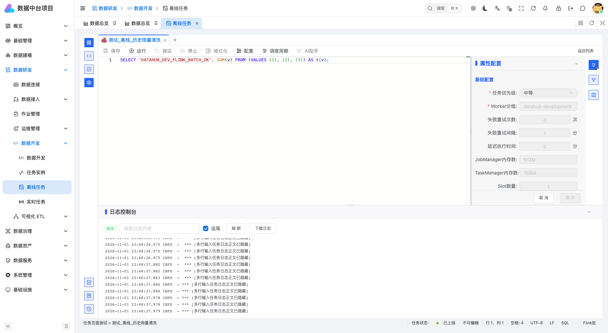

# 数据开发本地原生任务验收

2026-11-02，本任务的五个真实平台 API 场景、最终浏览器运行/停止及离线编辑器交互流程通过。对应的编号、状态、输出摘要、来源文件校验值见 [脱敏验收数据](development-native-runtime.json)。本报告仅覆盖本任务，不替其他聊天的改动或其他服务任务作验收结论；宽屏视觉附件见下方。

## 实际运行结果

| 场景 | 任务 / 记录 | DS 实例 | 平台终态 | 真实 Worker 证据 |
| --- | --- | --- | --- | --- |
| Flink SQL 批计算 | 7 / 2 | 43 | SUCCESS | 输出严格匹配，exit 0，完整进程树退出 |
| Spark SQL 批计算 | 8 / 4 | 45 | SUCCESS | 输出严格匹配，exit 0，完整进程树退出 |
| Flink 持续流停止 | 9 / 5 | 46 | STOPPED | 停止前已有真实输出，CANCELLED / -15，完整进程树退出 |
| Spark 长批计算停止 | 8 / 6 | 47 | STOPPED | 已真实进入 Spark 引擎，CANCELLED / 143，完整进程树退出 |
| Flink 错误 SQL | 10 / 7 | 48 | FAILED | CLI 实际 exit 1，完整进程树退出 |
| 浏览器 Flink 运行、持续、确认停止 | 11 / 11 | 55 | STOPPED | Worker 运行 **82 秒**，人工停止意图为 true，CANCELLED / -15，完整进程树退出 |

五个 API 场景均验证了相同 requestId 的幂等返回、最新运行记录、分页日志和下载日志。平台日志中的原生脚本正文已脱敏；批结果使用 root Worker 输出的严格标记与摘要校验，不能只凭 DS SUCCESS 推断结果正确。

最终 REA 证据为 `ev_5fddb7f92caf9e9b669f12016967db37e59c47d6a9dd9880270ac7da73668d65`：16 个步骤全部 completed，page errors 为 0，包含运行、等待 75 秒后仍运行、停止确认与终态读取。DS55 的 FLINK 子任务 56 于 `00:26:45` 开始、`00:28:07` 结束；节点配置为 `timeoutFlag=CLOSE`、`timeout=0`，工作流 timeout 也为 0。观察器账本从 manifest 创建至最终状态写入为 81.897 秒；该账本区间与上述 Worker 实际运行时间分别记录，避免把排队时间计为引擎运行时间。

只读检查范围为 `dh_native_2/4/5/6/7/10/11`，七个记录均 started、finished，processTreeAlive=false，且未发现范围内存活的 supervisor。原始证据为 `/tmp/dev-local-native-runtime/ui-worker-evidence.json`；汇总中只保留状态、时间、root 所有权、权限和 stdout 校验值。

## 运行边界与保留的失败记录

复用 DS 3.4.2、Java 17、Flink 1.20.3、Spark 3.5.6，运行档案为 `LOCAL`，Spark 固定 `local[1]`。当前只开放受管 Flink SQL / Spark SQL；并行度、CPU、实例数限为 1，内存只允许 512/768/1024 MB。同一存活观察器进程一次接纳一个引擎：[Runtime.launch](../native-runtime/local_runtime_observer.py#L291-L328) 在同一锁内检查存活 supervisor、创建并登记新 supervisor；后者直到整个后代树回收才结束。这是单进程接纳保护，不声明跨实例或跨重启的全局配额。不能由本次 SQL 验收推断 JAR、Python、YARN 或外部业务库端到端执行也已支持。

历史失败保留，不改写成成功：

- record1 因 Flink 非交互 SQL Client 缺少受管 TABLEAU result mode 而 FAILED；修复初始化参数后，后续真实批计算及持续流通过。
- record3 因旧观察器拒绝 DS 生成的有界 Spark 资源 `--conf` 而在引擎启动前失败。DS 实际退出码为 127，观察器 executions 为空。正式人工核查 API 使用 DS 日志及明确标为“仅参数策略重放”的 root 审计，把 UNKNOWN 收敛为 FAILED；未伪造引擎运行或终态。资源白名单已补齐，仍拒绝越界资源、JAR、额外 Java 参数和 YARN master。
- record10 暴露了零超时被序列化为 `CLOSE + 1` 的问题：DS 3.4.2 仅按数字分钟注册任务超时，60 秒后主动 Kill。现已改为 `CLOSE + 0`，最终 record11 真实运行 82 秒后由浏览器人工停止，证明不会在 60 秒自动结束。

本机曾因 Docker VM 系统内存超过 DS Master 的 80% 保护阈值，出现约 2–3 分钟排队。串行命令已被受理仍不等于 Worker 开始执行；平台将等待态保留为待提交/排队语义。保持负载保护及单作业预算，不以修改 DS 对象状态或关闭保护绕过等待。

普通 JDBC SQL 是既有执行能力，本轮没有新增另一套普通 SQL 执行底座。`executionConfig.workloadMode` 表示页面归属，`programConfig.workloadMode` 表示原生实际模式；旧任务回退到程序模式或离线。普通 SQL 可归实时页面，但仍为正超时的单次执行；Spark SQL 也可归实时页面，实际必须 BATCH 且正超时。查看样例为普通 SQL task13、Spark SQL task14；它们的分类展示不构成新增普通 SQL 运行验收。

原生运行记录 API 提供状态和日志，当前没有返回查询 rows 的接口；查询结果面板保留空态，不展示模拟结果。持续流的真实输出通过 Worker 日志核验。

## 布局与交互检查

同一离线编辑器的初始、执行历史、运行日志三态已读取真实 DOM 几何：业务区右边界均为 `1808px`，右侧辅助栏均为 `x=1753px`、宽 `54px`、右边界 `1807px`；各被测容器 `scrollWidth == clientWidth`，辅助栏保持在业务区内。Splitter 的尺寸约束通过组件 prop 传到实际根节点，工作区预留 54px 辅助栏，打开历史或日志不会把它挤出视口。数据见 `/tmp/dev-local-native-runtime/layout-metrics.log`，截图为 `/tmp/dev-local-native-runtime/layout-metrics-final.png`，两者摘要已记录在 JSON。

主任务反馈的宽屏 REA 检查覆盖业务属性、资源收起、minimap、历史、血缘和查询，全部步骤完成，page errors 为 0。1200px 和 768px 检查也全部完成；768px 下展开属性面板会压窄 SQL 编辑区，可收起属性面板使用，本次不声明手机适配。

最终离线“历史→成功运行日志→右侧属性→资源收起”的 REA 证据为 `ev_32e543a6b5dd1249ab30df54e2f41b0a9ebe0083f65f48204b6c62a883d2d473`，14 个步骤全部 completed，page errors 为 0。最终截图确认三处辅助栏、返回列表、属性、日志及底部状态栏均可见；宽屏视觉附件见下方。



血缘面板可以保存经过真实连接、Schema 和表校验的上下游关系；自动 SQL 血缘重解析尚未接入，按钮明确提示手动维护。当前不把空查询结果或未解析血缘显示为已完成分析。

本轮配置与运行修复没有新增 SQL/DDL，无新增 SQL 执行步骤。

## 配置、日志与复现

运行配置通过 [prepare_dev_native_runtime.py](../prepare_dev_native_runtime.py) 幂等创建或复用独立 `datahub-development-native-local` 项目与 `datahub-development` Worker 组，使用已有引擎环境和非 root `datahub` 执行用户，不重启 DS，不启动任务。默认私密文件是：

```text
deploy/dolphinscheduler-local/runtime/dev-native/application-native.yaml
deploy/dolphinscheduler-local/runtime/dev-native/ds-private.json
```

两文件均为 `0600` 且被 Git 忽略。本任务使用独立 DS token，原共享 token 未撤销；本报告不含 token、客户端私钥或其原文。普通服务使用 Spring `additional-location` 加载配置，证书位置及完整步骤见 [README](../README.md#普通-dataforge-服务加载本地运行配置) 与 [观察器部署说明](../NATIVE_RUNTIME.md)。

观察器在 loopback HTTPS 上使用 mTLS，仅返回精确名称/用户/引擎和生命周期。真正的原始 CLI 输出及 root 账本位于容器内：

```text
/var/lib/datahub-native-runtime/dh_native_<recordId>/manifest.json
/var/lib/datahub-native-runtime/dh_native_<recordId>/state.json
/var/lib/datahub-native-runtime/dh_native_<recordId>/output.log
```

文件均 root 独占、`0600`；平台分页与下载日志按现有规则脱敏并隐藏原生正文。验收文档仅保存 stdout 存在性、严格预期标记和 SHA-256，不复制原始日志或脚本。启动前拒绝另记 root `rejections` 审计，不冒充 executions 的完成状态。

从后端仓库根目录复现准备及聚焦检查：

```sh
python3 deploy/dolphinscheduler-local/prepare_dev_native_runtime.py \
  --ds-private deploy/dolphinscheduler-local/runtime/dev-native/ds-private.json \
  --tls-connection /tmp/datahub-native-runtime-connection.json
python3 deploy/dolphinscheduler-local/test_prepare_dev_native_runtime.py
python3 deploy/dolphinscheduler-local/native-runtime/test_runtime_contract.py
```

真实平台验收脚本为 [dev_native_smoke.py](../dev_native_smoke.py)，使用本地 `0600` 配置中的鉴权文件路径、API/观察器连接和明确的测试任务 allowlist。单次只执行一个场景，支持 `flink-batch`、`spark-batch`、`flink-stop`、`spark-stop`、`flink-failure`；脚本会保存测试任务、运行、必要时停止，并核验结果，执行前应使用独立测试任务与当前有效版本。

```sh
python3 deploy/dolphinscheduler-local/dev_native_smoke.py \
  --config /绝对路径/smoke-private.json \
  --case flink-batch --output /tmp/flink-batch.json
```

正式持续维护入口是 XXL-Job handler `devTaskJob`：同步 DS 绑定、导入触发实例，处理待提交、停止与恢复；业务 Cron 由 DS 执行。本次临时 `48087` 服务使用限定 taskId 的维护器隔离验收，不能把它作为正式调度部署。准备脚本不会创建或启用全局 XXL 任务，也不会修改既有 XXL 状态。

## 质量检查

- 前端完整 quality 在最终宽度样式小改前通过：418 个测试文件、3664 项测试通过，生产构建通过；原始检查记录为 `/tmp/dev-local-native-runtime/frontend-final-quality.log`。小改后另有 19 项聚焦测试、lint、全量 typecheck 和应用 build 通过；没有把此前完整套件结果表述为小改后重新全跑。
- 后端 quality：DB Switch 架构、编号迁移、错误码、模块边界门禁通过。最终聚焦运行分别为 domain 46、framework 30、contract 36 项通过；这些运行可能重叠，不相加为唯一测试总数。
- Python 观察器契约：宿主机 5 项通过、1 项 Linux 归属检查跳过；实际 Linux Worker 6 项全部通过，无跳过。真实 CLI 烟测此前已在 Worker 完成，见 [观察器证据](native-runtime-observer.json)。准备脚本另有 6 项测试通过，当前 DS 连续两次幂等 prepare 成功。

九份运行输入及布局日志、截图的 SHA-256 已写入脱敏 JSON，可据此核对本轮来源。后续视觉证据和其他模块验收应分别追加，不扩大上述运行结论。
