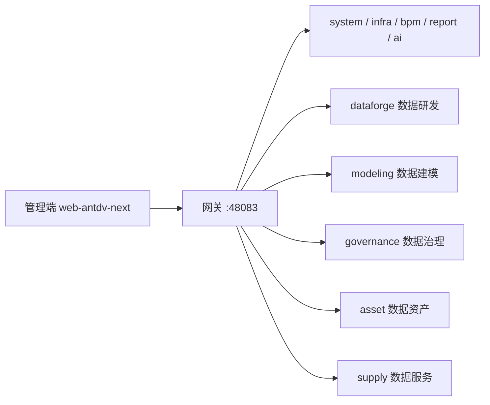

# 数据中台管理端

数据中台的管理后台前端。基于 [vue-vben-admin](https://github.com/vbenjs/vue-vben-admin) v5.7.0 与芋道 `yudao-ui-admin-vben` 二次开发。

本仓库只包含前端。后端仓库：<https://gitee.com/code-sculptor/yudao-cloud>，分支 `master-jdk25`。

远程仓库：<https://gitee.com/code-sculptor/yudao-ui-admin-vben>  
当前分支：`master`

本项目使用的应用是 **`apps/web-antdv-next`**（Ant Design Vue）。仓库里还有 `web-antd`、`web-ele`、`web-naive`、`web-tdesign`，不是本中台的主应用，日常开发和打包请走 antdv-next。

## 技术栈

| 项 | 说明 |
| --- | --- |
| Vue | 3.5 |
| Vite | 8 |
| TypeScript | 6 |
| UI | Ant Design Vue（web-antdv-next） |
| 状态 | Pinia |
| 路由 | Vue Router |
| 样式 | Tailwind CSS 4 |
| 包管理 | pnpm >= 11（强制，禁止 npm / yarn） |
| Node | ^22.18.0 或 ^24 |
| 工程 | pnpm monorepo + turbo |

## 和后端的关系

前端只调网关，不直连各个微服务。后端中台业务收敛为五个服务：**dataforge**（数据研发）、**modeling**（数据建模）、**governance**（数据治理）、**asset**（数据资产）、**supply**（数据服务）。原 foundation、integrate、develop 模块已拆掉：数据源等底座与同步、ETL、填报、SQL 开发能力并入 dataforge，分层、分类、主题域等归入 modeling。



本地开发默认：

- 页面：`http://127.0.0.1:5999`
- 网关：`VITE_BASE_URL=http://127.0.0.1:48083`
- 接口前缀：`VITE_GLOB_API_URL=/admin-api`

先启动后端网关和对应服务，再启动前端，否则登录和菜单会失败。

## 目录结构

```
yudao-ui-admin-vben
├── apps
│   └── web-antdv-next          # 本项目主应用
│       ├── .env                # 应用标题、租户等
│       ├── .env.development    # 本地端口、网关地址
│       ├── .env.production     # 生产构建
│       └── src
│           ├── api             # 接口封装，按后端模块分目录
│           ├── views           # 页面
│           │   ├── dataforge   # 数据研发
│           │   ├── modeling    # 数据建模
│           │   ├── governance  # 数据治理
│           │   ├── asset       # 数据资产
│           │   ├── supply      # 数据服务
│           │   ├── system      # 系统管理
│           │   └── bpm         # 工作流
│           └── locales
├── packages                    # 脚手架公共包，一般少改
├── internal
└── scripts
```

中台页面按后端模块放在 `apps/web-antdv-next/src/views` 和 `src/api` 下，不要写到 `web-ele` 等其它应用里。

## 已有中台页面（对照后端）

| 后端模块 | 前端目录 | 已有页面（部分） |
| --- | --- | --- |
| dataforge | views/dataforge | 概览、项目、数据源、驱动、数据库类型、来源系统；数据同步、API 接入、可视化 ETL（AntV X6 画布）、SQL 开发、数据探索、数据文件、在线填报（填报表 / 填报数据） |
| modeling | views/modeling | 主题域、数据分域、数仓分层、业务分类、业务主题；概念 / 逻辑 / 物理模型、模型检查、检查结果 |
| governance | views/governance | 数据标准（数据元、码表、标准文档）、数据质量（稽查规则、清洗规则、质量监控）、血缘、主数据（含分发）、数据安全（安全等级、分类、脱敏规则、白名单）、数据目录（目录数据 / 元数据 / 质量 / 清洗规则）、模型首页 |
| asset | views/asset | 目录资产登记、资产统计监控 |
| supply | views/supply | 服务概览、API 定义、API 类目、应用管理、API 测试、调用日志、仪表盘 |

系统管理、工作流沿用芋道页面。商城、CRM、WMS、支付等页面随脚手架残留，不是本中台交付范围，不要继续扩展。

## 环境要求

- Node.js `^22.18.0` 或 `^24`（不要用 18）
- pnpm `>= 11.0.0`（`packageManager` 为 pnpm@11.7.0）
- 已启动的后端网关（默认 48083）

未装 pnpm 时：

```bash
npm i -g pnpm
```

## 本地启动

在仓库根目录执行：

```bash
pnpm install
pnpm dev:antdv-next
```

浏览器打开 `http://127.0.0.1:5999`。

默认账号密码见 `apps/web-antdv-next/.env.development`（当前为 admin / admin123，上线前改掉）。

只改网关地址时，编辑：

`apps/web-antdv-next/.env.development`

```
VITE_PORT=5999
VITE_BASE_URL=http://127.0.0.1:48083
VITE_GLOB_API_URL=/admin-api
```

应用标题在 `apps/web-antdv-next/.env`：

```
VITE_APP_TITLE=数据中台项目
```

## 构建

```bash
pnpm build:antdv-next
```

产物在 `apps/web-antdv-next/dist`。生产接口地址改 `apps/web-antdv-next/.env.production`。

常用命令：

| 命令 | 说明 |
| --- | --- |
| pnpm install | 安装依赖 |
| pnpm dev:antdv-next | 启动本中台前端 |
| pnpm build:antdv-next | 生产构建 |
| pnpm lint | 代码检查 |

不要使用 `pnpm dev:ele`、`pnpm dev:antd` 作为本项目日常入口。

## 开发约定

- 新页面、新 API 只加在 `apps/web-antdv-next`
- 接口按后端模块分目录：`src/api/dataforge`、`src/api/modeling`、`src/api/governance`、`src/api/supply`、`src/api/asset`
- 页面按同样模块分目录：`src/views/dataforge`、`src/views/modeling` 等
- 菜单和权限由后端动态下发，前端路由与按钮权限标识与后端菜单配置一致
- 全市一个租户；部门隔离展示跟后端 `org_id` / 数据权限走，不要在前端再做一套租户切换给委办局
- 在线填报：填写人列表、导出必须走带行级权限的接口，不能只靠前端藏按钮
- 不要把密钥、真实网关账号提交进 Git；本地用 `.env.development`

## 和后端建设顺序对齐

| 阶段 | 前端先做 |
| --- | --- |
| P0 | 数据源实例、测通、浏览表字段（views/dataforge/database）联调 |
| P1 | 元数据目录树、表详情 |
| P2 | 离线库表同步任务与运行日志 |
| P2.5 | 在线填报：设计、选人、填报、审批、本人数据隔离 |
| P3 | 政务目录、共享申请（接 BPM） |
| P4 | 数据服务 API 配置与调用日志 |

## 相关仓库

| 仓库 | 说明 |
| --- | --- |
| https://gitee.com/code-sculptor/yudao-ui-admin-vben | 本前端 |
| https://gitee.com/code-sculptor/yudao-cloud | 后端，分支 `master-jdk25` |
| https://github.com/vbenjs/vue-vben-admin | 前端脚手架上游 |
| https://gitee.com/yudaocode/yudao-ui-admin-vben | 芋道前端上游 |

## 许可证

业务代码按项目组内部规定使用。底层来自 vue-vben-admin 与芋道前端脚手架，遵循其开源协议。
